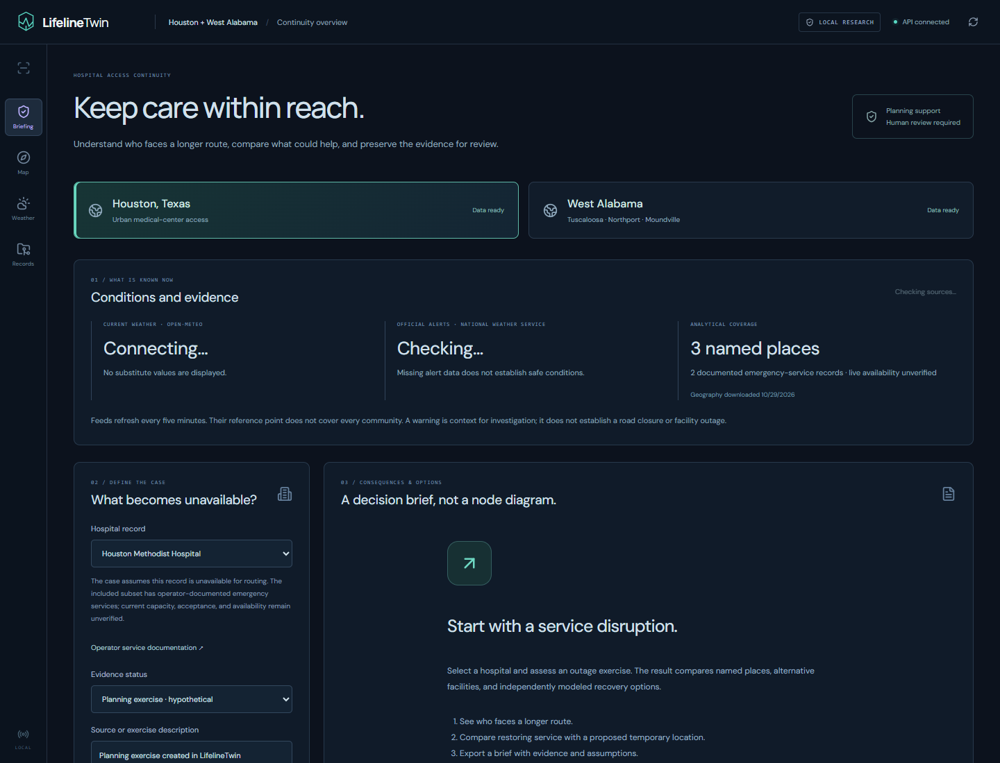
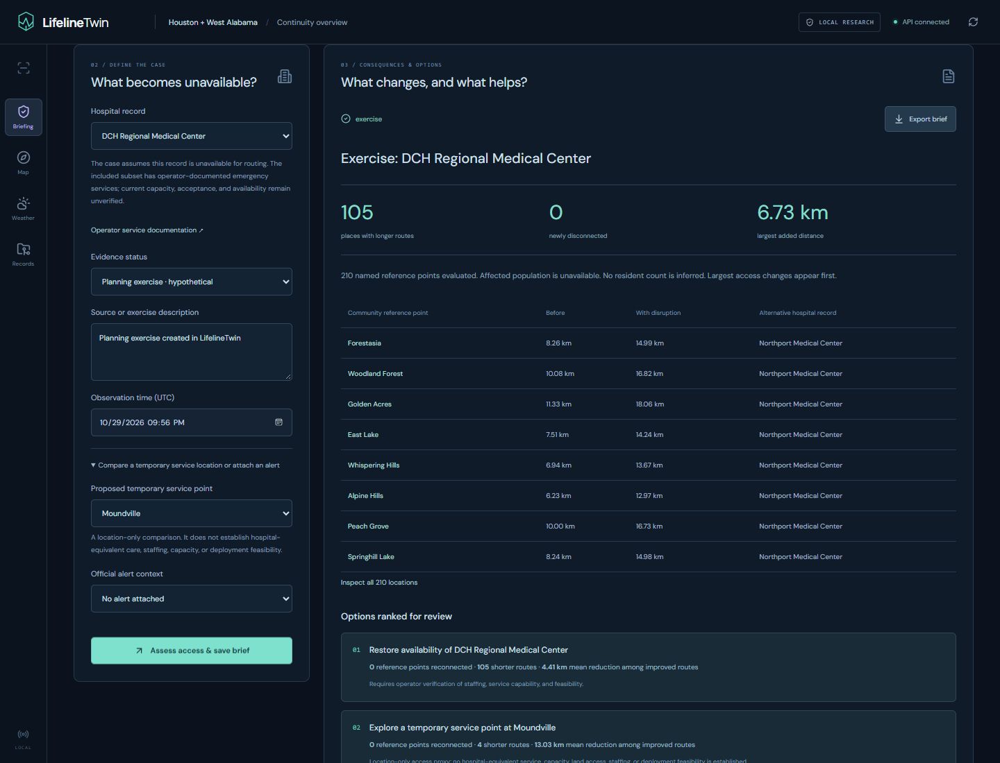
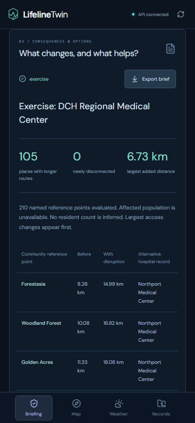

# LifelineTwin

**Hospital-access continuity planning for Houston and West Alabama.**

When a hospital becomes unavailable or a road is restricted, which places face longer routes to care—and which response option would improve access? LifelineTwin turns that question into a saved, evidence-backed planning case.

Built for **Open Agent Hackathon 2026** by **Abdullah Siddique**.

[Portfolio](https://abdullah-siddique-dev.netlify.app/) · [LinkedIn](https://www.linkedin.com/in/mr-abdullah-siddique/) · [GitHub](https://github.com/abdullah90907)

[Workflow](#the-workflow) · [Regions](#two-regional-pilots) · [Screenshots](#screenshots) · [Technology](#tools-and-models) · [Local setup](#run-locally)

## What the project does

LifelineTwin supports a regional planner reviewing a service disruption. Its main screen presents the available evidence, named places with changed access, alternative hospital records, and recovery comparisons. Technical node and layer controls live in the advanced map view.

A case can represent a **planning exercise** or a **user-reported disruption**. It records the source and observation time, calculates before-and-after access, ranks modeled alternatives, and exports a Markdown brief. A user report is not silently upgraded to independently verified information.

The current implementation measures **road-network distance from named reference points**. It does not estimate affected residents, ambulance response times, hospital capacity, or actual outage status.

## The workflow

1. **Choose a pilot.** Houston and West Alabama have separate geography, named locations, facility subsets, source feeds, and saved cases.
2. **Review what is known.** See current Open-Meteo conditions, official NWS alerts, source timestamps, and analytical coverage. Unavailable feeds remain unavailable; they do not become zero alerts or invented conditions.
3. **Define a case.** Choose a facility outage exercise or record a user-reported outage with its source and time. Exact road restrictions can also be passed from the advanced Houston map.
4. **Assess consequences.** Compare baseline access with the case conditions. See named reference points with longer routes, loss of access within the graph, and alternative documented emergency-service facilities.
5. **Compare responses.** Evaluate restoring facility availability, reopening a restricted road, or a proposed temporary service location. Options show how many reference points improve and their distance reductions.
6. **Preserve the explanation.** Save the case in SQLite, reopen it from the regional case list, and export its source, calculations, alternatives, limitations, and input checksum as a Markdown brief.

**A temporary location is a location-only access comparison. It does not establish hospital-equivalent care, staffing, capacity, site permissions, or deployment feasibility.**

## Two regional pilots

| | Houston, Texas | West Alabama |
| --- | --- | --- |
| Focus | Texas Medical Center continuity | Tuscaloosa–Northport–Moundville corridor |
| Driving graph | 2,804 nodes; 7,161 directed edges | 26,865 nodes; 66,035 directed edges |
| Named reference points in continuity cases | 3 OSM places | 210 OSM places |
| Documented emergency-service subset | Ben Taub and Houston Methodist | DCH Regional and Northport Medical Center |
| Advanced road investigation | Available | Continuity cases available; separate advanced Alabama map is not implemented |

Named places are OpenStreetMap reference locations, not population centroids or complete community boundaries. The earlier 25-point Houston grid is retained for advanced road analysis; it is not used as a population estimate in continuity cases.

### Why facility scope matters

A hospital tag alone does not establish appropriate emergency care. Continuity comparisons use an explicit subset with public operator documentation:

- [Ben Taub Hospital](https://www.harrishealth.org/locations-hh/Pages/ben-taub.aspx)
- [Houston Methodist Hospital Emergency Department](https://www.houstonmethodist.org/locations/texas-medical-center/emergency-department/)
- [DCH Regional and Northport emergency services](https://www.dchsystem.com/services/emergency-services/)

These sources document services. **Live availability, capacity, patient acceptance, and suitability for a particular case remain unverified.** Other mapped hospitals are not silently treated as equivalent alternatives. The included subset is not a complete regional directory.

## Screenshots

Actual captures from a real Edge browser:

### Regional briefing



### Alabama outage exercise



### Mobile result



### Advanced Houston map


## A measured planning example

In the recorded **DCH Regional outage exercise**, **105 of 210 named reference points** had longer routes to the remaining documented facility. The largest added distance was about **6.73 km**. None became newly disconnected within the downloaded graph.

A separate **Ben Taub outage exercise** increased the route distance for one of the three Houston reference points by about **1.01 km**. Both exercises were saved and reopened in the browser, and their briefs were exported.

These are hypothetical, bounded-network results—not observed hospital outages, counts of affected people, or instructions for patient transport. The saved [Alabama brief](evidence/continuity-release/alabama-brief.md), [Houston brief](evidence/continuity-release/houston-brief.md), and [browser verification](evidence/continuity-release/browser-results.json) contain the supporting records.

## What is live—and what changes the analysis

| Input | Role |
| --- | --- |
| Open-Meteo current conditions | Shows source-derived weather for a regional reference point |
| NWS active alerts | Provides official context; an alert can be attached to a case with its source snapshot |
| Explicit facility outage | Removes the selected facility from that case's routing alternatives |
| Explicit road restriction | Removes the exact selected graph segment and recalculates routes |
| Local Granite forecast | Supplies environmental predictions in the advanced investigation workflow |

Weather and alert feeds refresh every five minutes. Their reference-point coverage does not establish conditions throughout the region. **Warnings do not automatically close roads or declare hospitals unavailable.** There is no integrated verified traffic/road-closure feed.

## Tools and models

| Component | Implementation |
| --- | --- |
| Interface | React, TypeScript, Vite, TanStack React Query, Zod |
| Advanced map | MapLibre GL, attributed OSM street tiles, SVG compatibility renderer |
| Geographic data | OpenStreetMap, OSMnx, named place reference points |
| Routing | NetworkX shortest paths on directed driving graphs |
| Case API | Python, FastAPI, Pydantic |
| Persistence | SQLAlchemy and SQLite; region-scoped continuity cases |
| Live sources | Open-Meteo and the US National Weather Service |
| Local forecasting | IBM Granite TinyTimeMixer, PyTorch CPU, granite-tsfm |
| Scenario provenance | Meterless reference runtime in the existing advanced investigation workflow |
| Optional agent | LangGraph with a separately configured tool-calling LLM endpoint |

### Forecasting model

The existing advanced workflow uses `ibm-granite/granite-timeseries-ttm-r1`, a pretrained Hugging Face time-series model. It runs locally on CPU with a **512-hour context** and **96 hourly predictions**, without training or fine-tuning.

The new continuity calculations do not require an LLM or model inference: their routing and comparisons are reproducible geospatial calculations. Granite forecasts are environmental context, not a calibrated flood, closure, or emergency-demand model. Forecast skill and completed hosted-agent operation are not claimed.

### Comparison method

Facility-outage cases remove selected records from the eligible destination set. Road cases remove parallel edges between selected endpoints in both directions. The engine recomputes shortest distances and compares individual recovery alternatives while holding the other assumptions fixed.

Distance savings are reported across reference points. They are not population-weighted benefits, repaired-road length, response time, or cost-benefit estimates. The proposed temporary-site comparison measures proximity only.

## Run locally

Use the prepared Python 3.13 environment and Node.js 22.12+; Node 24 was verified.

Start the backend from the repository root:

```powershell
.\.venv-migration\Scripts\python.exe -m uvicorn lifelinetwin_backend.main:app --host 127.0.0.1 --port 8000
```

Start the frontend in a second terminal:

```powershell
Set-Location frontend
npm ci
npm run dev
```

Open [the continuity overview](http://127.0.0.1:5173/). Choose **West Alabama** to assess that pilot. The [advanced Houston map](http://127.0.0.1:5173/explore) remains available separately.

Both servers must run. Keep one backend instance per SQLite database. Current weather, alerts, and street tiles need internet; calculations use the downloaded geographic snapshots. The app is a local prototype with no production authentication.

### Data preparation

The repository includes the derived regional snapshots and checksums. Explicit acquisition scripts retain existing verified caches:

```powershell
.\.venv-migration\Scripts\python.exe scripts/prepare_houston.py
.\.venv-migration\Scripts\python.exe scripts/prepare_houston_communities.py
.\.venv-migration\Scripts\python.exe scripts/prepare_alabama.py
```

Raw OSM XML and acquisition caches are ignored by Git. Regenerating Houston named places requires its original raw OSM acquisition file. Model weights and the optional Meterless runtime are separately prepared assets; a clone alone is not a complete advanced forecasting environment. A clean-machine installation has not been verified. See [existing setup notes](docs/hackathon-demo.md), [Houston data notes](data/houston/README.md), and [Alabama data notes](data/alabama/README.md).

## API

| Endpoint | Purpose |
| --- | --- |
| `GET /continuity/regions` | Verified regional coverage, named places, and documented facility subset |
| `GET /continuity/signals/{region}` | Region-specific weather and official alert context |
| `POST /continuity/cases` | Calculate and save an explicit exercise or user report |
| `GET /continuity/cases?region=...` | List saved cases for one region |
| `GET /continuity/cases/{id}` | Retrieve the saved inputs and results |
| `GET /continuity/cases/{id}/brief` | Download the review brief as Markdown |

The advanced map can pass its exact selected road endpoints and graph checksum into a continuity case. A selection from a different snapshot is rejected.

## Verification and limits

The real-browser workflow exercises both regions, outage cases, proposed temporary sites, record reopening, Markdown exports, and mobile layout. Automated tests cover routing consequences, regional isolation, failed-alert handling, duplicate submissions, persistence across restart, and export contracts.

The release passed **66 targeted tests** (36 frontend, 14 continuity/feed, and 16 existing backend tests), plus the production frontend build. See the [release verification notes](docs/continuity-release.md).

Important limits remain:

- No population-impact estimate is implemented; named reference points are not resident counts.
- The bounded datasets and documented facility subset may omit viable alternatives outside coverage.
- Current capacity, acceptance status, traffic, turn restrictions, travel times, and dispatch feasibility are not modeled.
- User reports remain unverified; observation times do not reconstruct historical road or hospital conditions.
- Temporary service proposals require clinical, staffing, capacity, land-access, and operational review.
- The workflow has not been validated with an emergency planner or healthcare coalition, and is not a dispatch system.

## Hackathon and creator

**Open Agent Hackathon 2026** · **Abdullah Siddique**

Meterless remains in the advanced workflow. Zetaris is not connected, and no verified NVIDIA integration or completed hosted-agent run is claimed. The [dated submission assessment](HACKATHON_FINAL_READINESS.md) is historical evidence, not confirmation of eligibility or submission.

[Portfolio](https://abdullah-siddique-dev.netlify.app/) · [LinkedIn](https://www.linkedin.com/in/mr-abdullah-siddique/) · [GitHub](https://github.com/abdullah90907)

Geographic data: © OpenStreetMap contributors, ODbL. Weather and alert records retain their source provenance. See [the researched product direction](docs/impact-product-direction.md) for the reasoning behind the continuity workflow.
