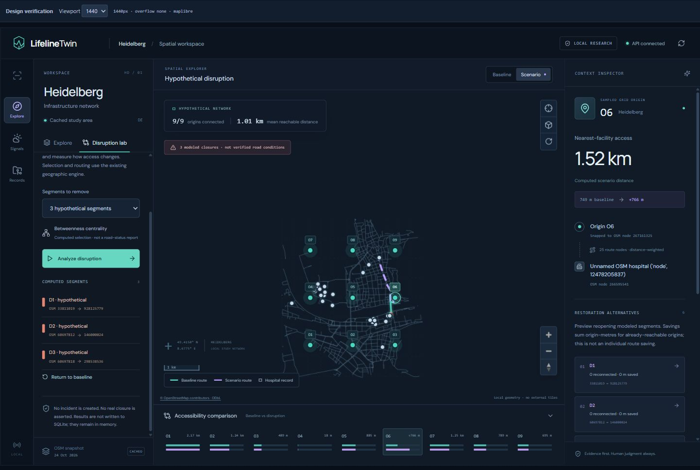
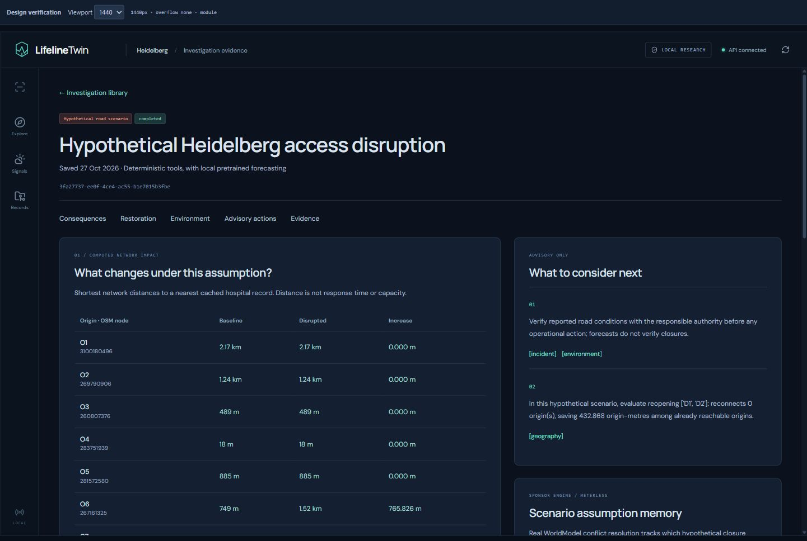
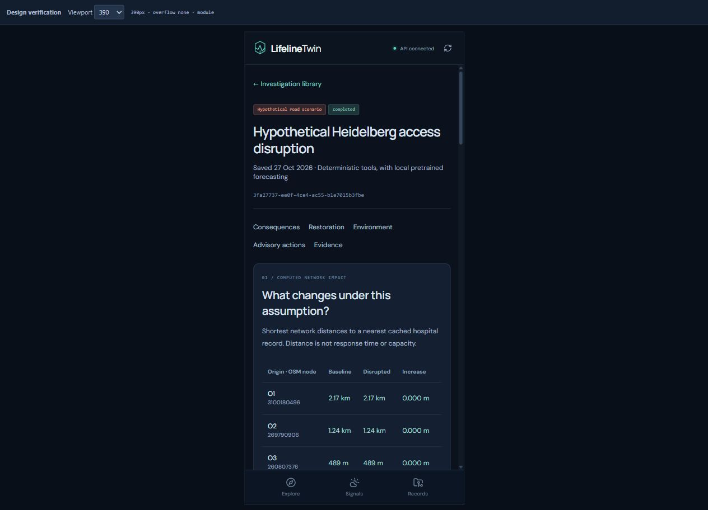

# LifelineTwin

**Understand how road disruptions change access to hospitals, compare recovery options, and inspect the evidence behind each recommendation.**

Built for **Open Agent Hackathon 2026** by [abdullah90907](https://github.com/abdullah90907).

## The challenge

A closed road can make a nearby hospital much harder to reach. Looking at a map alone does not explain which communities lose access, how much farther they must travel, or which combination of roads would be most useful to reopen. Weather adds context, while separate data sources make it difficult to trace the reasoning behind a decision.

LifelineTwin brings these questions into one investigation. A user creates a hypothetical disruption, measures its effect on hospital access, compares restoration options, and reviews weather evidence alongside recommendations. The current demonstration focuses on Heidelberg, Germany, using a cached road network and hospital records.

This is a local research prototype for planning and investigation. Its road closures are hypothetical, its routing measures distance, and its recommendations require human review.

## How it works

1. **Explore the area.** View the Heidelberg road network and hospital locations on an interactive map.
2. **Define a scenario.** Select road segments to treat as closed and set the investigation's evidence cutoff.
3. **Measure the impact.** Compare the shortest driving-network distance to a nearest cached hospital before and after the closures. Inspect affected origins and route geometry.
4. **Compare recovery options.** Evaluate individual reopenings and combinations, using reconnection and distance savings to identify useful alternatives.
5. **Inspect environmental context.** Review cached weather estimates and local time-series forecasts, including their source, model, and time boundaries.
6. **Review and save.** Read advisory actions with evidence references, inspect scenario assumptions, and save the investigation for later retrieval.

The saved evidence includes exact OpenStreetMap node identifiers, calculated paths, restoration metrics, model metadata, assumptions, and limitations. Recommendation citations open the corresponding evidence records.

## Demo screenshots

Screenshots from the working local application; the scenarios shown do not report live road incidents.

### Map and disruption exploration



### Saved investigation on desktop



### Saved investigation on mobile



## Tools and technology

| Component | Tools | Role in the project |
| --- | --- | --- |
| Web interface | React, TypeScript, Vite | Map exploration, scenario controls, investigation library, and evidence views |
| Map rendering | MapLibre GL | Displays local geographic geometry and analytical overlays |
| Frontend data and validation | TanStack React Query, Zod | Handles API data and validates frontend data structures |
| Backend API | Python, FastAPI, Pydantic | Validates requests and connects the analytical tools to the interface |
| Saved investigations | SQLAlchemy, SQLite | Stores investigations, evidence, results, and agent traces |
| Geographic analysis | OpenStreetMap data and the project's Python geographic engine | Computes hospital-access distances, disrupted routes, and restoration comparisons |
| Weather evidence | Open-Meteo | Supplies cached environmental estimates with timestamps and source metadata |
| Forecasting | IBM Granite TinyTimeMixer, PyTorch CPU, granite-tsfm | Runs pretrained time-series inference locally |
| Scenario memory | Meterless WorldModel reference engine, Node.js | Resolves scenario assumptions and records field-level provenance |
| Optional agent workflow | LangGraph and a configured tool-calling LLM endpoint | Lets an LLM select analytical tools and assemble evidence-bound findings |

## Which AI model is used?

The demonstrated forecasting model is **IBM Granite TinyTimeMixer**, specifically `ibm-granite/granite-timeseries-ttm-r1`. It runs locally on the CPU using pretrained weights, without training or fine-tuning.

The forecasting code uses a **512-hour context window** and produces **96 hourly predictions**. It supports continuous weather variables such as temperature, surface pressure, wind speed, and relative humidity. Precipitation and wind direction require special handling, which the implementation reports. Forecasts provide environmental context; they do not detect road closures or predict hospital response times.

A separate optional **LangGraph agent** can use an OpenAI-compatible Chat Completions endpoint with function calling. There is **no default LLM or fixed agent model**: the operator supplies the endpoint, model identifier, and credentials. The model selects tools and citations; the server validates numerical claims and evidence references. The demonstrated saved investigation uses a deterministic tool pipeline. A successfully completed hosted-LLM investigation has not been established in the recorded milestone.

## Hackathon and sponsor integrations

| Item | Project details |
| --- | --- |
| Event | Open Agent Hackathon 2026 |
| Problem addressed | Evidence-backed investigation of infrastructure disruption and hospital access |
| Creator | [abdullah90907](https://github.com/abdullah90907) |
| Repository | [LifelineTwin](https://github.com/abdullah90907/LifelineTwin) |
| Meterless | Integrated through the real WorldModel reference engine for scenario assumptions, conflict resolution, and provenance |
| Zetaris | Not connected; no completed Zetaris query is claimed |
| NVIDIA | No verified NVIDIA integration is claimed |

Meterless records which hypothetical closure assumptions remain active and which are superseded by a restoration preview. These records describe the scenario rather than verified observations of road conditions. Its optional runtime reports an explicit unavailable state if it cannot run; the analytical workflow can continue.

See the [submission-readiness assessment](HACKATHON_FINAL_READINESS.md) for recorded evidence and remaining requirements. It is a dated assessment, not confirmation of submission or sponsor eligibility.

## A concrete example

In the recorded Heidelberg investigation, the cached graph contains **1,060 nodes**, **2,331 directed edges**, and **nine origin locations**. Three hypothetical road closures were applied.

For one origin, the nearest-hospital driving distance increased from about **749 metres to 1,515 metres**, an increase of about **766 metres**. All nine origins remained connected to a hospital. Reopening either of two selected segments alone produced no savings, while reopening them together saved about **433 origin-metres** across the evaluated origins.

Origin-metres are the sum of distance savings across origins. They do not represent travel time, population benefit, repair cost, or ambulance response time. This example shows why comparing combinations can reveal improvements that individual reopenings miss.

The saved investigation was retrieved after a backend restart and checked against the geographic engine. Supporting screenshots and verification outputs are in [the recorded demo evidence](evidence/challenge-readiness-20261027/).

## Run the local demo

The following commands use the already prepared Python 3.13 environment and cached data/model assets. Use Node.js 22.12 or newer; Node 24 was verified in the recorded setup.

Start the API from the repository root:

```powershell
$env:HF_HUB_OFFLINE = '1'
$env:TRANSFORMERS_OFFLINE = '1'
.\.venv-migration\Scripts\python.exe -m uvicorn lifelinetwin_backend.main:app --host 127.0.0.1 --port 8000
```

In a second terminal, start the frontend:

```powershell
Set-Location frontend
npm ci
npm run dev
```

Open [the local application](http://127.0.0.1:5173). The default database is `data/backend/lifelinetwin.sqlite3`. Use a single backend instance per database.

The repository alone does not include every runtime asset. Another machine needs the Python dependencies, original Heidelberg cache, local frontend atlas, Hugging Face model cache, and the separately installed Meterless reference runtime. A fresh-machine installation has not been verified. Follow the [demo and setup runbook](docs/hackathon-demo.md) for asset preparation, runtime setup, alternative ports, and the demonstration walkthrough.

## Current boundaries

- Road closures are user-defined hypotheses, not a live incident feed.
- Access calculations use network distance to cached hospital records. They do not account for live traffic, hospital capacity, or emergency response time.
- Weather estimates and model predictions carry their own time and source limitations. Forecasting accuracy for operational use has not been established.
- The working demonstration is local and has no public demo URL or production authentication.
- The optional hosted agent and unconnected sponsor tools should not be interpreted as completed integrations.

## Repository guide

| Location | Contents |
| --- | --- |
| `frontend/` | React application and map interface |
| `lifelinetwin_backend/` | API, persistence, investigation workflow, and optional agent |
| `lifelinetwin_geo/` | Geographic calculations, weather handling, and forecasting |
| `scripts/` | Data preparation, integration checks, and workflow verification |
| `tests/` | Analytical and backend tests |
| `docs/` | Setup instructions, methods, and technical notes |
| `evidence/` | Recorded outputs, screenshots, and verification artifacts |
| `data/heidelberg/` | Geographic snapshot information and attribution |

## Data and attribution

Geographic analysis uses OpenStreetMap data; see the [Heidelberg data notes](data/heidelberg/README.md) for snapshot details and attribution. Environmental evidence comes from Open-Meteo. Forecasting uses IBM Granite TinyTimeMixer, and scenario provenance uses the upstream Meterless reference implementation. Their respective data, model, and software licenses apply.

Research inspiration includes adaptive forecasting and lightweight learning under changing conditions (Prof. Zimeng Lyu), and geospatial relationships and agentic spatial services (Prof. Xinyue Ye). The project does not reproduce their published research.
