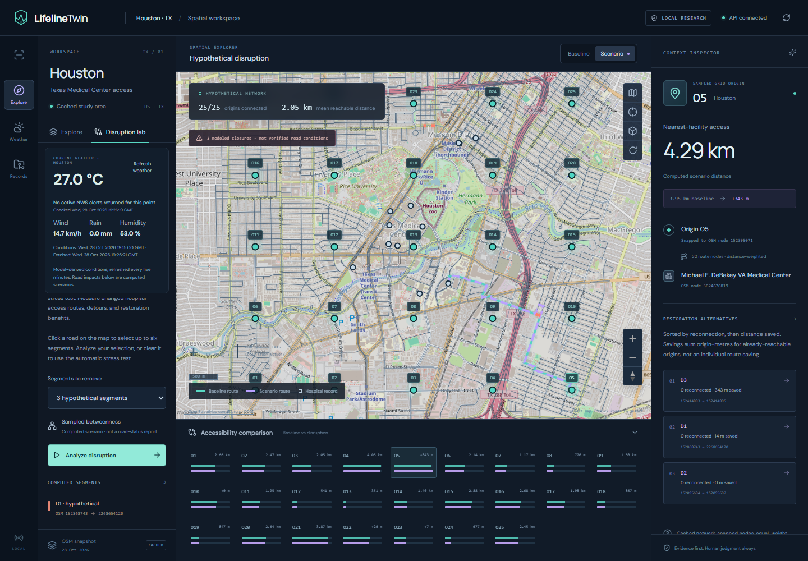
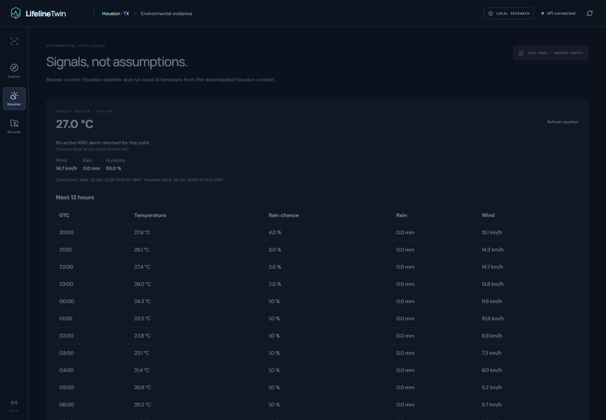
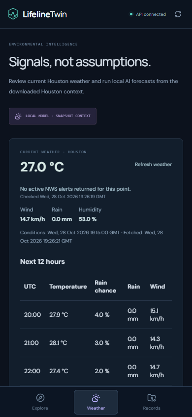

# LifelineTwin

**Hospital access under pressure — an interactive resilience workspace for Houston, Texas.**

Explore the Texas Medical Center and Brays Bayou area on a labelled street map, inspect current weather and official alerts, close selected road segments in a scenario, and measure how hospital access changes.

Built for **Open Agent Hackathon 2026** by **Abdullah Siddique**.

[Portfolio](https://abdullah-siddique-dev.netlify.app/) · [LinkedIn](https://www.linkedin.com/in/mr-abdullah-siddique/) · [GitHub](https://github.com/abdullah90907)

[Features](#what-you-can-do) · [Demo](#screenshots) · [Models](#ai-and-analytical-methods) · [Setup](#run-locally) · [Data](#data-and-limitations)

## Why Houston?

Hospitals can remain operational while surrounding roads become difficult to access. Houston's Texas Medical Center makes that distinction concrete: flooding during Hurricane Harvey impeded travel to the medical center even after flood-protection improvements protected facilities. [Texas Medical Center's account](https://www.tmc.edu/news/2018/07/the-worlds-largest-medical-city-is-ready-for-the-storm/) describes the access problem.

LifelineTwin asks a practical planning question: **if these road segments become unavailable, which sampled locations face longer hospital routes, and which reopening would help?**

The active study area is a bounded part of Houston, rather than the whole city. Its real OpenStreetMap snapshot contains **2,804 road nodes, 7,161 directed edges, 25 sampled origins, and 12 hospital records**. The earlier Heidelberg dataset is retained for historical evidence and regression tests.

## What you can do

| Feature | How it works |
| --- | --- |
| Labelled street map | OpenStreetMap streets, place names, and landmarks beneath the analytical network; toggle to an offline network view |
| Road-name search | Search streets such as Old Spanish Trail and select specific intersection-to-intersection segments |
| Direct road selection | Click roads to select up to six hypothetical closures; selected segments are highlighted |
| Hospital-access analysis | Compare shortest driving-network distances before and after closures, respecting the cached graph's directions |
| Recovery comparison | Inspect individual reopenings and, when individual reopenings offer no benefit, pairs of reopenings |
| Current weather | Open-Meteo conditions for Houston, with source and retrieval timestamps, manual refresh, and five-minute updates |
| Near-term outlook | A 12-hour table of temperature, rain probability, precipitation, and wind |
| Official US alerts | National Weather Service alerts for the study-area point, including severity, descriptions, instructions, and expiry |
| Local AI forecasting | Run IBM Granite TinyTimeMixer over downloaded Houston weather context; select temperature, wind, humidity, or pressure |
| Saved investigations | Preserve exact road endpoints, routes, forecasts, recommendations, and evidence references in SQLite |
| Scenario memory | Meterless records scenario assumptions and their provenance when its reference runtime is available |

**Current weather and alerts are external feeds. Road impacts are calculated what-if scenarios on a downloaded network. The application does not claim live traffic or verified road-closure detection.**

## Screenshots

Actual browser captures of the Houston implementation:

### Houston street map and selected-road analysis



### Current weather, official alerts, and outlook



### Mobile weather view



## Try the workflow

1. Open **Explore** to inspect Houston's medical-center network and hospital records.
2. Search a street name or click a road segment. Select up to six roads; click a selection again to remove it.
3. Choose **Analyze disruption**. The app sends those exact OSM endpoint pairs to the backend and calculates the changed routes.
4. Select an origin to inspect its baseline route, scenario distance, and destination hospital.
5. Compare reopening alternatives in the inspector. Reopening benefits are measured across sampled origins.
6. Create a saved investigation to retain the scenario, local model output, and supporting evidence.
7. Open **Weather** for current conditions, NWS alerts, the next 12 hours, and local AI forecasting.

A selected road can have zero measured effect. That is a valid computed result: an alternative route may remain available, or the segment may not serve the sampled origins.

### Measured Houston example

In the verified three-segment stress test, four of the 25 sampled origins had longer hospital routes. Origin O5 increased from **3.950 km to 4.293 km**, a **343-metre detour**. All 25 origins remained connected. The browser then saved the investigation successfully with **96 local Granite forecast values**. These are computed scenario results, not observed storm impacts.

## AI and analytical methods

### Local forecasting model

**IBM Granite TinyTimeMixer** — `ibm-granite/granite-timeseries-ttm-r1` — runs on the CPU using existing pretrained Hugging Face weights. The implementation uses a **512-hour context** to produce **96 hourly predictions**, without training or fine-tuning.

This is time-series extrapolation of weather variables. It does not detect flooding, road closures, or hospital demand. Forecasting skill against held-out observations has not been established. The local model uses a downloaded context snapshot, while the current-weather panel retrieves new provider data independently.

### Routing and restoration

The Python geographic engine uses a directed OpenStreetMap driving graph and NetworkX shortest-path calculations. Closures remove parallel edges between a selected endpoint pair in both directions. Other carriageways remain separate. The optional automatic stress test selects baseline-used segments ranked by length-weighted edge betweenness. For networks above 1,500 nodes, the interactive stress test uses 128 sampled sources with a fixed seed for reproducibility.

Restoration alternatives are ranked by reconnected origins and aggregate distance savings. **Origin-metres** means the sum of savings across sampled origins; it does not measure population benefit, repair cost, or response time.

### Optional LLM agent

A separate LangGraph workflow supports a configured OpenAI-compatible endpoint with function calling. The operator supplies the endpoint, model identifier, and credentials; there is no default hosted LLM. The demonstrated main workflow is deterministic. A completed hosted-agent investigation is not claimed.

## Technology

| Layer | Tools |
| --- | --- |
| Interface | React, TypeScript, Vite, TanStack React Query, Zod |
| Mapping | MapLibre GL, OpenStreetMap raster tiles, cached OSM geometry, SVG compatibility renderer |
| API and validation | Python, FastAPI, Pydantic |
| Geographic analysis | OSMnx, NetworkX |
| Weather and alerts | Open-Meteo, US National Weather Service |
| Local model | IBM Granite TinyTimeMixer, PyTorch CPU, granite-tsfm |
| Persistence | SQLAlchemy, SQLite |
| Scenario provenance | Meterless WorldModel reference engine |
| Optional agent | LangGraph and a separately configured tool-calling LLM |

```text
Houston map and road selection
              |
           FastAPI
              +-- OSM graph --> hospital-access and restoration analysis
              +-- Open-Meteo --> current conditions and hourly outlook
              +-- NWS -------> active official weather alerts
              +-- Houston weather snapshot --> local Granite TTM forecast
              +-- Meterless --> scenario assumptions and provenance
              |
     Evidence and advisory actions --> SQLite
```

## Run locally

Use the prepared Python 3.13 environment and Node.js 22.12+; Node 24 was verified. Houston is the default backend region.

Start the API from the repository root:

```powershell
.\.venv-migration\Scripts\python.exe -m uvicorn lifelinetwin_backend.main:app --host 127.0.0.1 --port 8000
```

Start the frontend in a second terminal:

```powershell
Set-Location frontend
npm ci
npm run dev
```

Open [the local application](http://127.0.0.1:5173). The API and frontend must both run. Keep one backend instance per SQLite database.

Current weather, alerts, and street tiles require internet access. The cached analytical network remains usable without those feeds. Provider errors are displayed instead of fabricated current data. The map also has a compatibility renderer for devices without working WebGL.

To prepare Houston data explicitly on another machine after installing dependencies:

```powershell
.\.venv-migration\Scripts\python.exe scripts/prepare_houston.py
.\.venv-migration\Scripts\python.exe scripts/export_frontend_atlas.py --region houston
```

Existing verified geography is retained. The model weights and Meterless runtime are separately prepared assets; a repository clone alone is not a complete runtime installation. See [setup details](docs/hackathon-demo.md) and [the Houston data notes](data/houston/README.md). The older runbook includes historical Heidelberg examples; Houston instructions above supersede its location-specific defaults.

## Validation

A real headless Edge browser exercised road-name search, manual selection, the geographic API, the Houston weather view, and mobile rendering. Captures and the machine-readable result are in [Houston browser evidence](evidence/houston-showcase/). Controlled frontend tests also cover map failure recovery and the API request contracts.

See the [showcase audit](docs/showcase-audit.md) for historical findings and remaining limits. Running tests or producing model outputs alone does not establish operational effectiveness.

## Data and limitations

- **Geography:** OpenStreetMap contributors, ODbL. Routes use the downloaded graph; roads outside its boundary are excluded.
- **Hospitals:** tagged OSM hospital nodes and closed ways within the medical-center acquisition box. Relations are excluded; this is not a complete hospital directory or a statement of emergency-service availability.
- **Origins:** 25 sampled grid locations with equal weight, rather than population-weighted communities or live patient locations.
- **Routing:** distance between snapped road nodes; traffic, travel time, hospital capacity, and ambulance dispatch are not modelled.
- **Weather:** model-derived provider conditions and forecasts, with five-minute application caching. They are not verified road observations.
- **Alerts:** NWS alerts apply to the queried point. No returned alerts does not establish that every location or road is safe.
- **Deployment:** local prototype with no production authentication or public deployment.

Public street tiles follow the [OSM tile-use policy](https://operations.osmfoundation.org/policies/tiles/), with visible attribution and ordinary browser caching. No bulk tile download is implemented. `VITE_MAP_TILE_URL` allows a compatible alternative tile endpoint; update attribution when changing providers.

## Hackathon and integrations

**Event:** Open Agent Hackathon 2026. **Focus:** evidence-backed infrastructure and hospital-access investigation.

Meterless is integrated through its reference engine. Zetaris is not connected, and no verified NVIDIA integration or completed hosted-agent run is claimed. The [dated submission assessment](HACKATHON_FINAL_READINESS.md) records earlier requirements and limitations; it does not establish submission or sponsor eligibility.

## Repository guide

| Location | Contents |
| --- | --- |
| `frontend/` | Map, weather, scenario controls, and saved evidence views |
| `lifelinetwin_backend/` | API, current weather, alerts, persistence, and optional agent |
| `lifelinetwin_geo/` | Geographic engine, weather ingestion, and local forecasting |
| `data/houston/` | Active geographic snapshot, hospital records, origins, and weather context |
| `scripts/` | Acquisition, atlas export, and verification tools |
| `tests/` | Analytical and backend regression tests |
| `evidence/houston-showcase/` | Actual Houston browser captures and verification results |

## Creator

**Abdullah Siddique**

[Portfolio](https://abdullah-siddique-dev.netlify.app/) · [LinkedIn](https://www.linkedin.com/in/mr-abdullah-siddique/) · [GitHub](https://github.com/abdullah90907)
